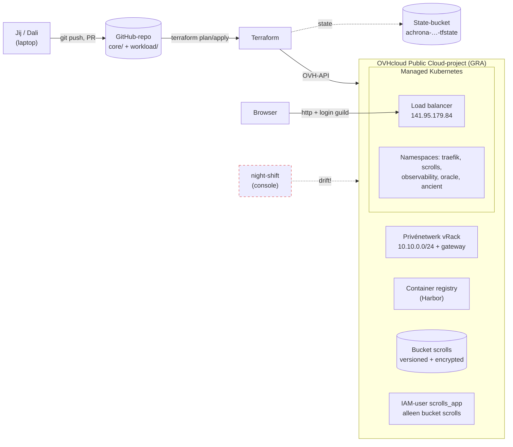
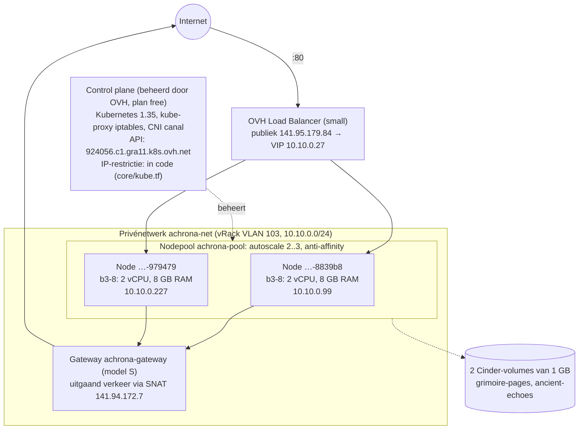
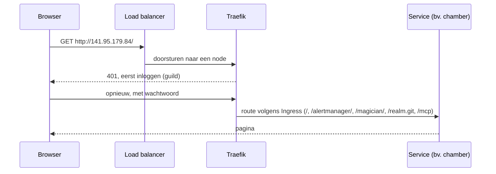
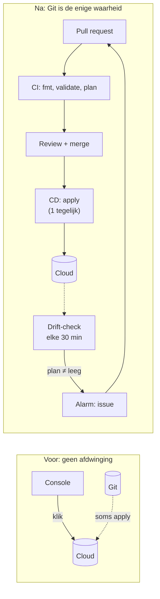

# Architectuur: wat draait er, en hoe hangt het samen?

Deze pagina legt uit wat er in ons OVHcloud-project staat, waarom de code in twee delen
(`core/` en `workload/`) zit, hoe de Kubernetes-cluster is opgebouwd en hoe we drift tegenhouden.
Het drift-rapport van level 1 staat in [`bewijs/level-1/drift-rapport.md`](bewijs/level-1/drift-rapport.md).

## 1. Het grote plaatje

Er zijn maar **twee legitieme manieren** om iets te veranderen: via Terraform (vanuit Git) of via de
apps zelf (bv. Ixeth die in de grimoire commit). Alles wat via de console gebeurt, zoals de wijzigingen
van *night-shift*, noemen we **drift**: de werkelijkheid wijkt dan af van wat in Git staat.

## 2. Waarom `core/` en `workload/` apart?

Kort: **`core/` bouwt de cluster, `workload/` zet dingen óp de cluster.**
Vergelijk het met een gebouw: `core/` is de grond, de muren, de elektriciteit en de sleutels.
`workload/` is de inrichting en de mensen die erin werken.

| | `core/` | `workload/` |
|---|---|---|
| Maakt | netwerk, gateway, Kubernetes-cluster + nodepool, registry, bucket, IAM-user | Traefik (website + login), de chart `kube-monitoring` (scrolls, collector, Ixeth, Alertmanager, grimoire), de Ancient Oracle |
| Praat met | de **OVH-API** | de **Kubernetes-API** (via de providers `helm` en `kubernetes`) |
| Providers | `ovh` | `ovh`, `helm`, `kubernetes`, `random` |
| Verandert | zelden (infrastructuur) | vaak (apps, images, charts) |
| Eigenaar (team) | wimmevdv (level 1+2) | wimmevdv (`*.tf`) + Dali (charts, images: level 3+4) |
| State | `core`-key in de state-bucket | eigen `workload`-key |

Waarom splitsen?

1. **Kip of ei.** De providers `helm` en `kubernetes` hebben het adres en het certificaat van de cluster
   nodig. Die bestaan pas nádat `core/` de cluster gemaakt heeft. In één Terraform-run kun je een provider
   niet configureren met iets dat in diezelfde run nog moet ontstaan. Daarom komt eerst `core`, dan `workload`.
2. **Kleinere blast radius.** Een fout in een Helm-chart kan nooit per ongeluk je netwerk of cluster slopen.
   Een `apply` op `workload/` raakt alleen de inhoud van de cluster.
3. **Sneller en apart werken.** Een `plan` op `workload/` hoeft niet alle OVH-infra te checken. En omdat het
   twee aparte states zijn, kunnen een apply op `core/` en een apply op `workload/` elkaar niet in de weg zitten.
4. **Andere ritmes.** Infra verandert een paar keer per project, apps verschillende keren per dag.

`workload/` leest wat het van `core/` nodig heeft (het cluster-ID, de registry-URL en het wachtwoord) uit de
**state van `core/`** (`terraform_remote_state` in `workload/main.tf`).

## 3. De Kubernetes-cluster in detail

**Wat er op die 2 nodes draait** (de scheduler verdeelt de pods zelf):

| Namespace | Pods | Waarvoor | Level |
|---|---|---|---|
| `traefik` | traefik | voordeur: de load balancer stuurt alles hierheen, met basic auth (`guild`) | |
| `scrolls` | scrolls-app, magician | de "app" van het rijk; gebruikt de bucket `scrolls` | 2 |
| `observability` | metrics-collector | scrapet elke minuut nodes, pods en `/metrics` (heeft veel te veel rechten: level 2) | 2 |
| `oracle` | ixeth, sentinel, alertmanager, grimoire | de incident-agent en zijn hulpjes | 3 |
| `ancient` | ancient-oracle | MCP-server voor AI-assistenten | 4 |
| `kube-system` | canal, kube-proxy, CSI, konnectivity, … | systeempods van OVH | |

**Instellingen in de code** (`core/kube.tf`, `core/variables.tf`):

- `plan = "free"`: OVH beheert de control plane, wij zien enkel de nodes.
- `update_policy = "MINIMAL_DOWNTIME"`: OVH installeert patches met zo weinig mogelijk onderbreking.
- Nodepool `b3-8`, autoscaling **min 2 / max 3**, `anti_affinity = true` (nodes op verschillende hypervisors).
- `ovh_cloud_project_kube_iprestrictions`: wie de API mag bereiken. Staat open (`0.0.0.0/0`), want de API vraagt
  sowieso het clientcertificaat uit de kubeconfig en de GitHub-runners hebben geen vast IP. Belangrijk is dat
  het **in de code staat**: elke wijziging in de console is nu zichtbaar als drift.

**Hoe een request binnenkomt:**

## 4. Drift: hoe het fout ging en hoe we het tegenhouden

Drift heeft twee vormen, en elke vorm vraagt een eigen aanpak:

| Soort | Voorbeeld | Ziet `terraform plan` het? | Aanpak |
|---|---|---|---|
| **Gewijzigd** wat Terraform beheert | update policy, bucket-encryptie, S3-policy | ja | `apply` zet het terug |
| **Niet beheerd** door Terraform | IP-restrictie (stond niet in de code) | nee | resource toevoegen aan de code (+ `import`) |
| **Ghost resource** (extra ding) | `hotfix-pool`, `debug-admin`, extra S3-key | nee | `import` en daarna uit de code halen, zodat `apply` het vernietigt |

Het complete overzicht met tijden, beslissingen en bewijs staat in het
[drift-rapport](bewijs/level-1/drift-rapport.md).

## 5. Valkuilen die we tegenkwamen

- **Geen state locking.** De S3-backend heeft hier geen lock. Twee applies tegelijk op dezelfde state maken die
  kapot. Afspraak: "APPLY START/KLAAR" op het issue. Straks lost de pipeline het op met één `concurrency`-groep.
- **Quirk van de provider bij `object_lock` van de bucket.** Na de wijziging in de console geeft de API een leeg
  `object_lock`-blok terug. De provider wilde daardoor de bucket **vervangen** (= data kwijt). Opgelost met
  `ignore_changes = [object_lock]` en `prevent_destroy = true`, plus een eenmalige correctie van de state
  (bewijs in het drift-rapport).
- **Een wijziging aan de IP-restrictie zet de cluster even op `REDEPLOYING`.** Andere wijzigingen aan de
  cluster of nodepool in dezelfde apply falen dan. Even wachten en opnieuw `plan`/`apply`.
