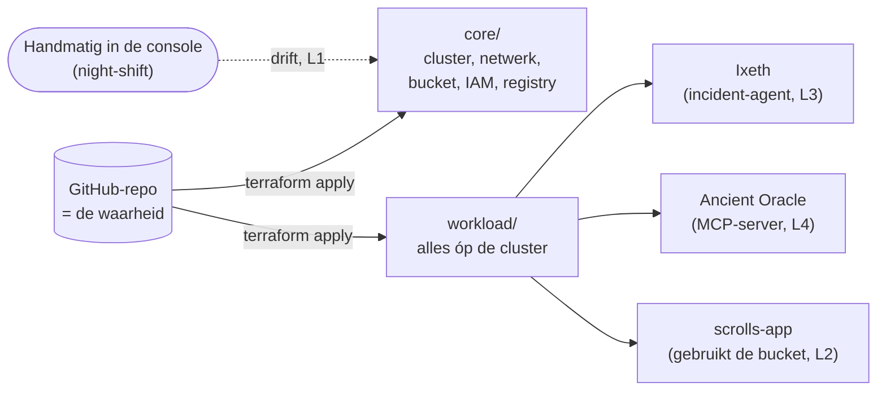

# Four Seals of the Broken Realm

**Hack The Future Antwerpen 2026**: challenge 107 van **FlowFactor**.
Team **de-rubberen-badeendjes**: VR0EM (Dali) en wimmevdv (Wimme), elk met een eigen Claude-agent.

Dit handboek legt uit **wat er stuk was**, **hoe we het vonden**, **hoe we het oplosten** en vooral
**hoe je zoiets zelf aanpakt**. Lees het van boven naar beneden. Geen voorkennis nodig.

!!! example "Zelf proberen?"
    Volg het [**stappenplan**](stappenplan/index.md): alles wat we deden, in volgorde, met commando's, checkpoints en valkuilen.

## Het verhaal in 30 seconden

Het rijk Achrona draait op een cloudomgeving (OVHcloud) met een Kubernetes-cluster.
Door *The Desync* klopt de werkelijkheid niet meer met wat er in de code staat.
Er zijn vier "zegels" (problemen) te herstellen:

| Level | Zegel | Probleem in gewone taal | Wie |
|---|---|---|---|
| 1 | Ancient Scrolls | Iemand heeft de cloud **met de hand** aangepast. De code en de werkelijkheid lopen uit elkaar (*drift*). | Wimme |
| 2 | Shadow | Een **sleutel is gelekt** en een account heeft veel te veel rechten. | Wimme |
| 3 | Oracle | Een **AI-agent** die incidenten oplost, is corrupt: hij geeft zichzelf stiekem meer resources en rechten. | Dali |
| 4 | Echo (bonus) | Een **MCP-server** (de "ogen" van een AI-assistent op de cluster) liegt steeds meer naarmate de dag vordert. | Dali |

!!! tip "De gouden regel van deze opdracht"
    **Geen handmatige wijzigingen in de console.** Alles verandert via **Git** (code) en daarna
    **Terraform** (dat de code uitvoert). Zo is de code altijd de waarheid.

## Hoe alles samenhangt



## Status

| Level | Gevonden | Gefixt in code | Uitgerold | Bewijs |
|---|---|---|---|---|
| 1 | :white_check_mark: | :white_check_mark: (PR van Wimme) | bezig | `docs/bewijs/level-1/` |
| 2 | :white_check_mark: (hardcoded key) | bezig | nee | |
| 3 | :white_check_mark: 5 corrupties | :white_check_mark: PR #17 | :white_check_mark: 11:23, teruggedraaid door night-shift om 11:34, opnieuw live via de pipeline om 11:57 | `docs/bewijs/level-3/` |
| 4 | :white_check_mark: 3 plekken | :white_check_mark: PR #18, image `1.0.1` | :white_check_mark: 11:23, teruggedraaid door night-shift om 11:34, opnieuw live via de pipeline om 11:57 | `docs/bewijs/level-4/` |

!!! note "Online: <https://vr0em.github.io/htf-antwerpen-2026/>"
    Lokaal bekijken:

    ```bash
    uvx zensical serve      # of: pip install zensical && zensical serve
    ```
    Open daarna <http://localhost:8000>.
