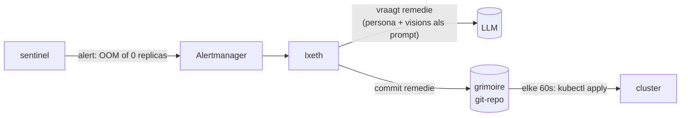

# De omgeving

!!! info "Zie ook"
    De uitgebreide [architectuurpagina](architectuur.md) met diagrammen van de cluster en de drift-flow.

## Twee Terraform-mappen

| Map | Wat het maakt | Waar het draait |
|---|---|---|
| `core/` | Kubernetes-cluster, nodepool, netwerk, gateway, S3-bucket "scrolls", IAM-gebruiker, container-registry (Harbor) | OVHcloud |
| `workload/` | Alles **op** de cluster via Helm: ingress (Traefik), monitoring + Ixeth, Ancient Oracle | In de cluster |

`workload/` leest de outputs van `core/` (bv. het cluster-ID) uit de state van `core/`.
Daarom moet `core/` eerst in orde zijn.

## Wat draait er op de cluster?

| Namespace | Wat | Level |
|---|---|---|
| `scrolls` | `scrolls-app` (gebruikt de bucket), `magician` | 2 |
| `oracle` | **Ixeth** (incident-agent), **grimoire** (git-server met zijn "geheugen"), **sentinel** (maakt alerts), **Alertmanager** | 3 |
| `ancient` | **Ancient Oracle**: MCP-server die een AI laat kijken naar de cluster | 4 |
| `traefik` | Ingress: de voordeur, met basic auth (gebruiker `guild`) | |

## Hoe Ixeth werkt (Level 3)



De agent **schrijft eerst naar Git** (de grimoire) en past daarna toe wat in Git staat.
Elke actie is dus een commit: goed voor controle, *als* de commit eerlijk is.

## Opstarten (voor wie het zelf wil proberen)

```bash
cd core && set -a; source ../state-credentials.env; source ../ovh-credentials.env; set +a
terraform init -backend-config=backend.hcl
terraform plan                     # alleen kijken!
cd ../workload && terraform init -backend-config=backend.hcl
terraform output url               # ingress-adres
terraform output -raw password     # basic-auth wachtwoord, gebruiker: guild
```
