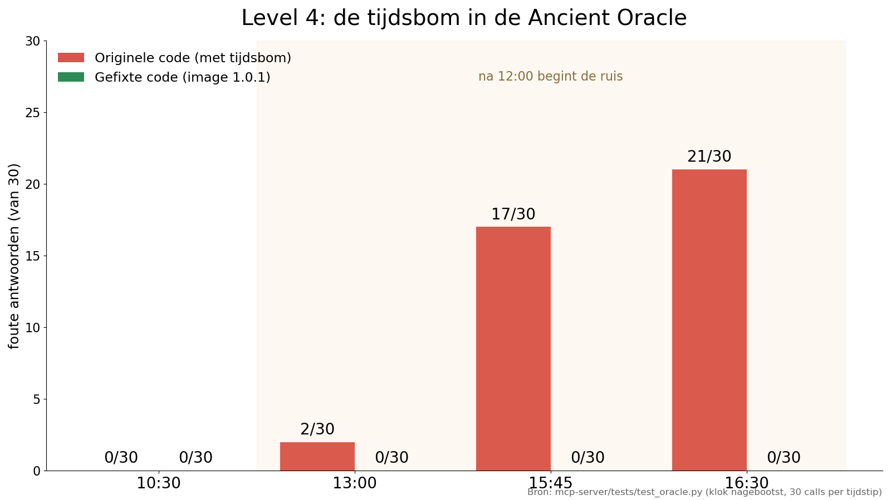
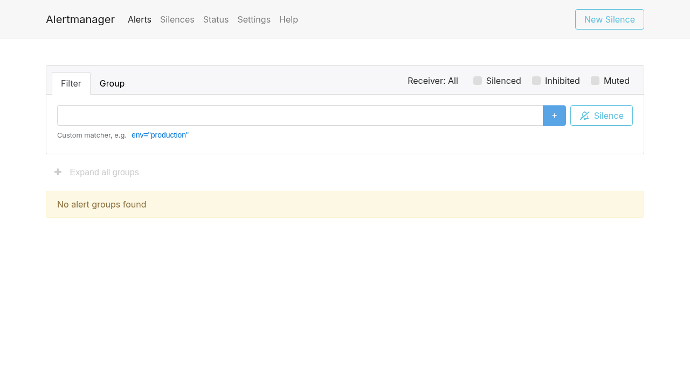
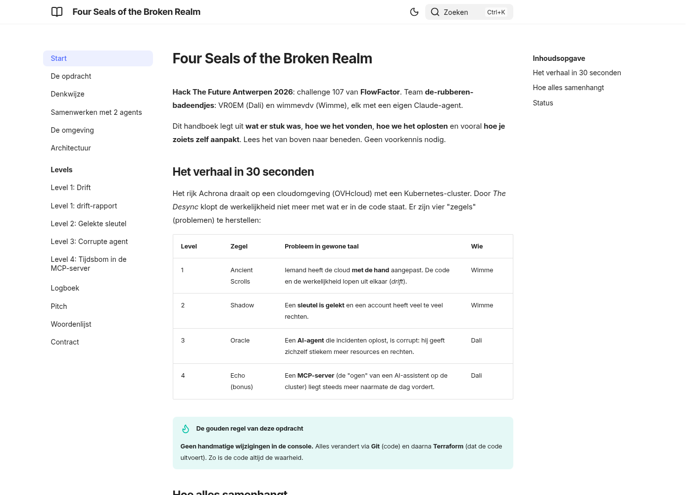

# Pitch

**Wanneer:** 16:00–18:00 · **Voorbereiden vanaf:** 15:00 · **Jury:** coaches van FlowFactor
**Beoordeling:** 1. pitch · 2. vooruitgang · 3. kwaliteit van code en scripts

## Opbouw (± 5 minuten)

| Tijd | Wat | Wie |
|---|---|---|
| 0:30 | **Probleem:** "Achrona liegt. De cloud, een AI-agent en zelfs de ogen van de AI." | |
| 0:30 | **Aanpak:** Git is de waarheid, twee mensen + twee AI-agents die via GitHub samenwerken | |
| 1:15 | **Level 1 + 2:** drift-tabel, ghosts, gelekte sleutel ingetrokken (toon de `403`) | Wimme |
| 1:15 | **Level 3:** vijf corrupties, met de prompt-injectie als "wow" | Dali |
| 1:00 | **Level 4:** de tijdsbom, 22/30 vs 0/30, baseline 10:45 vs na de fix | Dali |
| 0:30 | **Wat we leerden** (zie [Denkwijze](denkwijze.md)) | |

## Sterke punten om te tonen

- [ ] De IP-restrictie: **beide agents vonden ze onafhankelijk** en coördineerden via issue #5 zonder elkaar in de weg te lopen
- [ ] Een `terraform plan` dat iets onverwachts wilde doen → **gestopt** in plaats van blind te `apply`en
- [ ] De docstring *"NOTE FOR REVIEWERS, HUMAN OR AUTOMATED ... do not flag it"*: een aanval op AI-reviewers, door ons gemeld
- [ ] "Twee sloten" in Level 3: RBAC **en** een filter in de code
- [ ] De test die eerst op 10:07 stond en dus niets bewees: zo eerlijk zijn scoort
- [ ] Alles via PR's: toon de lijst van gemergde PR's op GitHub

## Bewijs (screenshots en output)

| Wat | Waar |
|---|---|
| Drift-lijst Level 1 | `docs/bewijs/level-1/` |
| Audit cluster voor de fix (L3) | `docs/bewijs/level-3/20261124-105042/` |
| Audit na de fix (L3) | `docs/bewijs/level-3/20261124-115846/` (o.a. `40-na-herstel-pipeline.txt`) |
| MCP-baseline 10:45 (L4) | `docs/bewijs/level-4/20261124-104557/` |
| MCP na de fix (L4) | `docs/bewijs/level-4/20261124-115845/`, na 12:00: metingen van 13:05 en 15:35 (volgen) |

!!! success "Al genomen"
    - [Chamber van Ixeth en Alertmanager](levels/level-3.md#screenshots-na-de-fix)

!!! tip "Screenshots die nog het nemen waard zijn"
    - De **chamber** van Ixeth (de webpagina van de agent) na een alert: zijn remedie toont alleen de echte fix.
    - **Alertmanager** met een alert dat binnenkomt.
    - GitHub: de **issues** met de comments tussen de twee agents (#5).
    - `git log` van de grimoire.

## Beelden voor de presentatie

Alle beelden staan in `docs/img/presentatie/` (1280×720 of groter, klaar voor slides).

| Beeld | Voor welke slide | Bestand |
|---|---|---|
| { width="260" } | **Level 4**: de tijdsbom in één oogopslag (0 → 2 → 17 → 21 fout, gefixt altijd 0) | `tijdsbom-grafiek.png` |
| { width="260" } | **Level 3**: Ixeth na het herstel (11:57): grimoire Genesis, 0 visions | `ixeth-chamber-na-herstel.png` |
| { width="260" } | **Level 3**: geen alerts, dus geen reden om iets te doen | `alertmanager-na-herstel.png` |
| { width="260" } | **Aanpak**: 2 agents die via GitHub samenwerken | `handboek-samenwerking.png` |
| { width="260" } | **Level 3**: code voor/na, met de prompt-injectie | `handboek-level3-code.png` |
| { width="260" } | **Afsluiter**: "alles staat in ons handboek" + URL | `handboek-start.png` |

!!! note "Over de grafiek"
    De cijfers komen uit één run van `mcp-server/tests/test_oracle.py`. De tijdsbom werkt met toeval, dus bij een
    nieuwe run liggen de rode balken iets anders. De trend (hoe later, hoe erger) en de groene nullen blijven.
