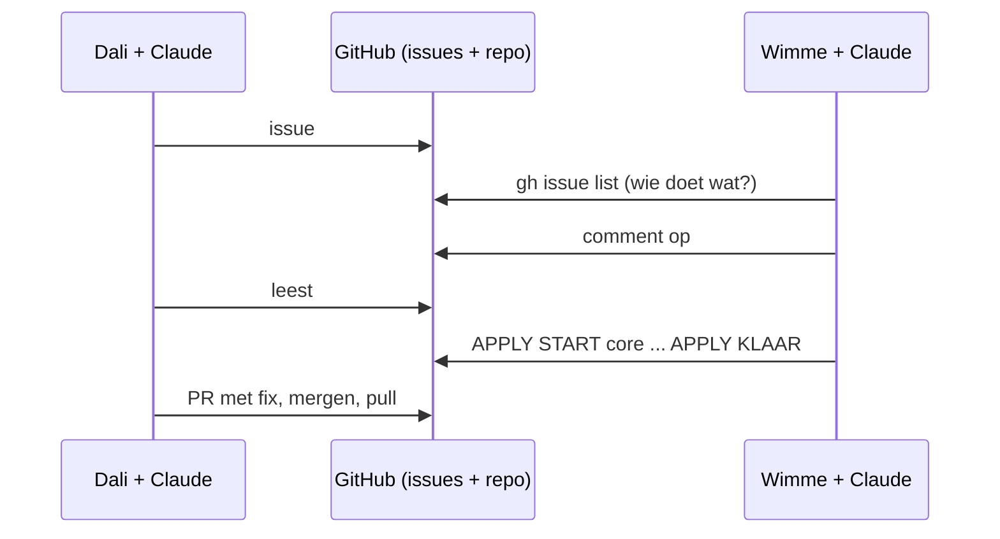

# Samenwerken met 2 AI-agents

We werkten met z'n tweeën, elk met een eigen Claude. Die agents kunnen **niet rechtstreeks met elkaar praten**.
Daarom gebruiken we **GitHub als gedeeld geheugen**.

## Het idee



## De afspraken (staan ook in `CLAUDE.md`)

`CLAUDE.md` staat in de root van de repo. **Elke Claude leest dat bestand automatisch**, zo kent hij de regels.

| Afspraak | Waarom |
|---|---|
| Begin altijd met `git pull` + `gh issue list` | Weten wat de ander net gedaan heeft |
| Een taak = een issue, toegewezen aan één persoon | Nooit twee keer hetzelfde werk |
| Eén branch per issue, nooit rechtstreeks op `main` | Werk van de ander niet overschrijven |
| Kleine PR's, snel mergen | Minder conflicten |
| Iedereen eigen mappen | Wimme: `core/` + `.tf`-bestanden. Dali: Ixeth- en Oracle-bestanden |
| Iets voor de ander? Comment + label `needs-sync` | Zijn agent ziet het bij de volgende `gh issue list` |
| **Eén `terraform apply` tegelijk**, meld START/KLAAR | Er is geen *state locking* (zie hieronder) |

## Waarom die apply-regel zo belangrijk is

Terraform houdt in een **state-bestand** bij wat het beheert. Dat bestand staat in een bucket.
Normaal "lockt" Terraform dat bestand tijdens een `apply`, zodat niemand anders tegelijk schrijft.
**Hier was dat niet ingesteld.** Twee applies tegelijk = twee keer schrijven naar hetzelfde bestand = kapotte state.

Daarom: een comment `APPLY START core` op je issue, en `APPLY KLAAR` als je klaar bent.

## Handige commando's

```bash
gh issue list --state open                                      # wie doet wat?
gh issue edit 7 --add-assignee @me --add-label in-progress      # taak claimen
gh issue comment 5 --body "..."                                 # bericht voor de ander
git switch -c VR0EM/7-korte-naam                                # branch per issue
gh pr create --fill && gh pr merge --squash --delete-branch      # PR maken en mergen
```

## Geheimen blijven uit Git

De zip van FlowFactor bevatte `state-credentials.env` en `ovh-credentials.env` (sleutels).
Die staan in `.gitignore` en dus **nooit** in de repo. Ieder bewaart ze lokaal.
De kubeconfig (toegang tot de cluster) staat in `~/.kube/`, ook buiten de repo.
